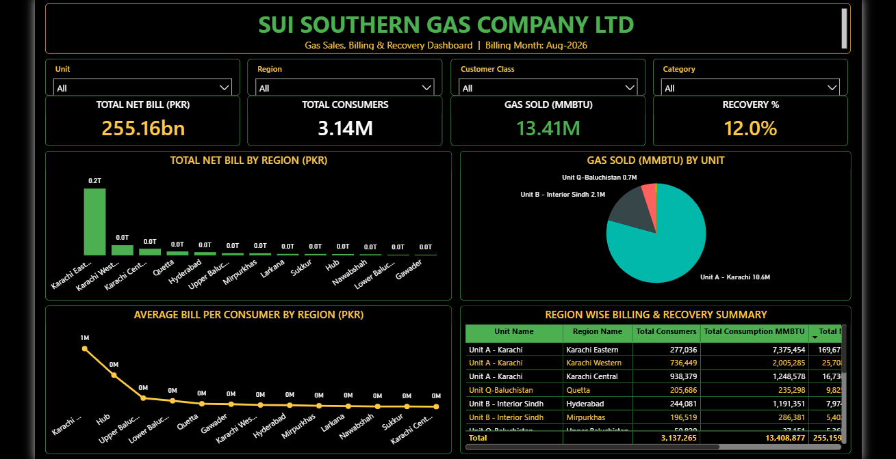
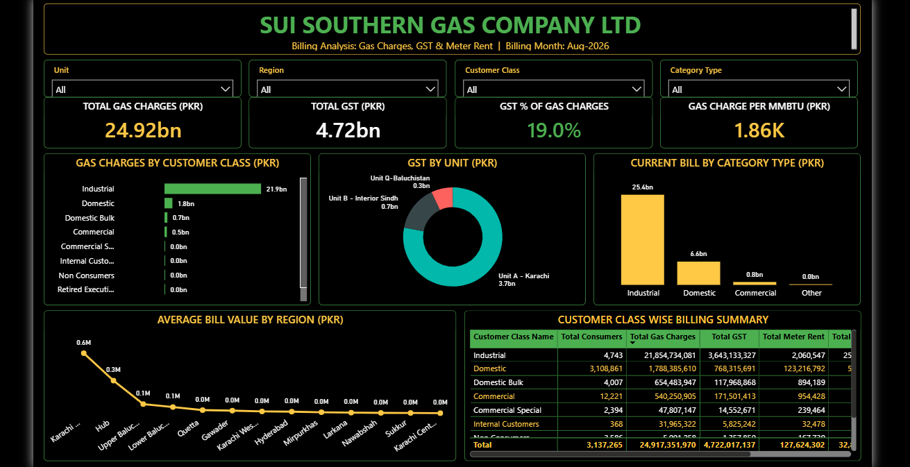
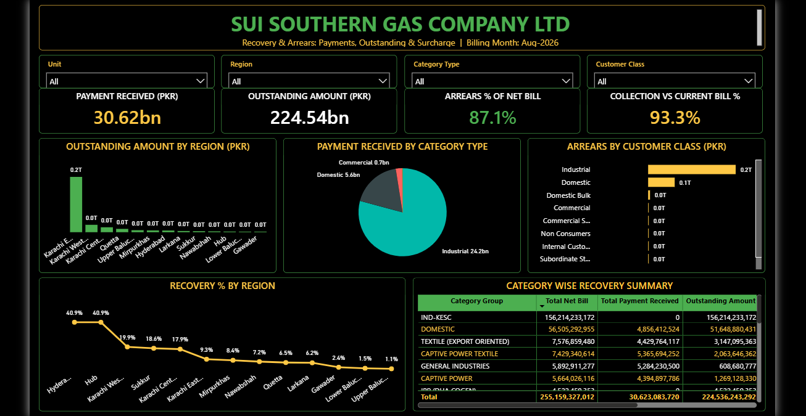
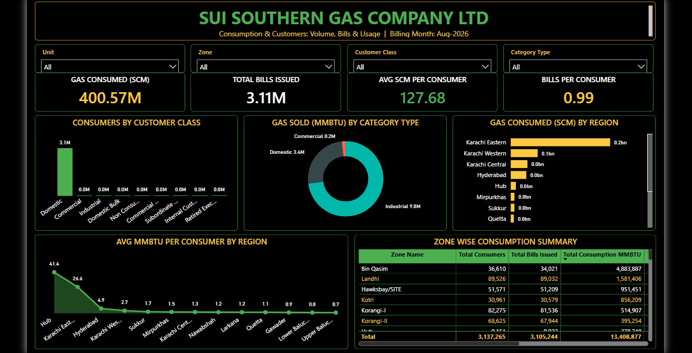

# SSGC Gas Sales, Billing & Recovery Analytics

An end-to-end data analytics project built during an internship at **Sui Southern Gas Company Limited (SSGC)**. The project transforms large, multi-file billing data into an interactive Power BI reporting suite covering gas sales, billing, taxes, consumption, recovery and arrears for the billing month **August 2026**.

---

## Table of Contents

1. [Project Overview](#project-overview)
2. [Objectives](#objectives)
3. [Tech Stack](#tech-stack)
4. [Workflow](#workflow)
5. [Data Description](#data-description)
6. [Methodology](#methodology)
   - [1. Data Collection](#1-data-collection)
   - [2. Exploratory Data Analysis (Python)](#2-exploratory-data-analysis-python)
   - [3. Data Extraction (SQL)](#3-data-extraction-sql)
   - [4. Data Cleaning & Transformation (Power Query)](#4-data-cleaning--transformation-power-query)
   - [5. Data Modeling & DAX Measures (Power BI)](#5-data-modeling--dax-measures-power-bi)
   - [6. Dashboard Development](#6-dashboard-development)
7. [Dashboards](#dashboards)
8. [Key KPIs](#key-kpis)
9. [Key Insights](#key-insights)
10. [Repository Structure](#repository-structure)
11. [How to Use](#how-to-use)
12. [Limitations & Future Scope](#limitations--future-scope)
13. [Disclaimer](#disclaimer)
14. [Author](#author)

---

## Project Overview

SSGC distributes natural gas to millions of consumers across Sindh and Balochistan. Billing data is generated at a very large scale and was initially distributed across **multiple Excel files**, which made it difficult to analyze collectively, track recovery performance, or monitor arrears.

This project consolidates that data, validates and cleans it, calculates business KPIs, and presents the results in four interactive dashboards that support management-level decision making.

## Objectives

- Consolidate multiple large Excel files into a single, reliable analytical dataset.
- Understand the structure, quality and distribution of the data through exploratory analysis.
- Extract only the relevant data required for KPI computation using SQL.
- Clean, standardize and transform the data for reporting.
- Define reusable DAX measures for billing, recovery and consumption KPIs.
- Deliver interactive dashboards with slicers for Unit, Region/Zone, Customer Class and Category.

## Tech Stack

| Layer | Tool |
|---|---|
| Source Data | Microsoft Excel (multiple files) |
| Exploratory Data Analysis | Python (Pandas, NumPy, Matplotlib / Seaborn) |
| Data Extraction | SQL |
| Data Cleaning & Transformation | Power Query Editor |
| Modeling & Calculations | DAX |
| Visualization | Power BI Desktop |

## Workflow

```
Multiple Excel Files (Large Dataset)
            |
            v
Python  -->  Exploratory Data Analysis (EDA)
            |
            v
SQL     -->  Data Extraction for KPI Calculation
            |
            v
Power Query Editor  -->  Data Cleaning & Transformation
            |
            v
Power BI Desktop  -->  DAX Measures  -->  Dashboards
```

## Data Description

The dataset contains consumer-level billing records for **August 2026**, covering approximately **3.14 million consumers**. Major attributes include:

- **Organizational:** Unit, Region, Zone
- **Customer:** Customer Class, Category Type / Category Group
- **Consumption:** Gas consumed (SCM), Gas sold (MMBTU), Bills issued
- **Billing:** Gas charges, GST, Meter rent, Current bill, Total net bill
- **Recovery:** Payment received, Outstanding amount, Surcharge

> The actual company data is confidential and is **not** included in this repository.

## Methodology

### 1. Data Collection

The raw data was provided as several large Excel workbooks. These files were reviewed for structure, column consistency and record volume before any analysis was performed.

### 2. Exploratory Data Analysis (Python)

Python was used to understand the data before building the reporting layer. Activities included:

- Loading and combining the multiple Excel files into DataFrames.
- Inspecting shape, data types and summary statistics.
- Identifying missing values, duplicate records and inconsistent entries.
- Detecting outliers in consumption and billing amounts.
- Studying distributions by region, customer class and category.
- Verifying that totals reconcile across files.

The findings from EDA guided the SQL extraction logic and the cleaning rules applied later.

### 3. Data Extraction (SQL)

Because of the dataset's size, SQL was used to extract only the fields and records needed for KPI calculation. Typical tasks included:

- Selecting required columns and filtering to the relevant billing period.
- Joining dimension and fact tables (unit, region, customer class, category).
- Aggregating data by region, zone, customer class and category.
- Producing optimized result sets for loading into Power BI.

### 4. Data Cleaning & Transformation (Power Query)

The extracted data was loaded into Power Query Editor, where it was prepared for modeling:

- Correcting data types (numeric, text, date).
- Handling null, blank and invalid values.
- Removing duplicates and unnecessary columns.
- Standardizing naming conventions for regions, units and categories.
- Trimming and cleaning text fields.
- Merging and appending queries where required.
- Creating derived columns to support analysis.

### 5. Data Modeling & DAX Measures (Power BI)

Relationships were established between the fact and dimension tables, and DAX measures were created for the KPIs, for example:

```DAX
Total Net Bill = SUM ( Billing[NetBill] )

Total Consumers = DISTINCTCOUNT ( Billing[ConsumerID] )

Gas Sold MMBTU = SUM ( Billing[ConsumptionMMBTU] )

GST % of Gas Charges = DIVIDE ( [Total GST], [Total Gas Charges] )

Arrears % of Net Bill = DIVIDE ( [Outstanding Amount], [Total Net Bill] )

Avg SCM per Consumer = DIVIDE ( [Gas Consumed SCM], [Total Consumers] )
```

> Table and column names above are illustrative; refer to the `.pbix` file for the exact implementation.

### 6. Dashboard Development

Four themed dashboards were designed with a consistent dark layout, KPI cards, charts, summary tables and slicers for interactive filtering.

## Dashboards

### 1. Gas Sales, Billing & Recovery
Overall performance snapshot: total net bill, consumers, gas sold, recovery %, bill by region, gas sold by unit, average bill per consumer and a region-wise summary.



### 2. Billing Analysis: Gas Charges, GST & Meter Rent
Breakdown of gas charges, GST and meter rent by customer class and unit, with the average bill value by region.



### 3. Recovery & Arrears
Payments received, outstanding amounts, arrears percentage and collection vs. current bill, analyzed by region, category and customer class.



### 4. Consumption & Customers
Gas volume, bills issued, consumption per consumer and zone-wise consumption summary.



## Key KPIs

| KPI | Value (Aug 2026) |
|---|---|
| Total Net Bill | PKR 255.16 bn |
| Total Consumers | 3.14 M |
| Gas Sold | 13.41 M MMBTU |
| Recovery % | 12.0% |
| Total Gas Charges | PKR 24.92 bn |
| Total GST | PKR 4.72 bn |
| GST % of Gas Charges | 19.0% |
| Gas Charge per MMBTU | PKR 1.86 K |
| Payment Received | PKR 30.62 bn |
| Outstanding Amount | PKR 224.54 bn |
| Arrears % of Net Bill | 87.1% |
| Collection vs Current Bill | 93.3% |
| Gas Consumed | 400.57 M SCM |
| Total Bills Issued | 3.11 M |
| Avg SCM per Consumer | 127.68 |
| Bills per Consumer | 0.99 |

## Key Insights

- **Unit A - Karachi** accounts for the largest share of gas sold and billing; Karachi Eastern leads in total net bill.
- **Industrial** customers contribute the bulk of gas charges, while **Domestic** customers form the vast majority of the consumer base.
- Outstanding arrears are heavily concentrated in a few regions and in the industrial segment.
- Recovery percentage varies widely across regions, with Hyderabad and Hub performing highest in the observed month.
- GST remains consistent at roughly 19% of gas charges.

## Repository Structure

```
SSGC-Analytics-Project/
├── data/                 # Sample / dummy data only (no confidential data)
├── python/               # EDA notebooks and scripts
├── sql/                  # SQL extraction queries
├── powerbi/              # .pbix file and Power Query steps
├── images/               # Dashboard screenshots
└── README.md
```

> Adjust the folder names to match your actual repository.

## How to Use

1. Clone the repository:
   ```bash
   git clone https://github.com/<your-username>/<repository-name>.git
   ```
2. Install the required Python libraries:
   ```bash
   pip install pandas numpy matplotlib seaborn jupyter
   ```
3. Open the notebooks in the `python/` folder to review the EDA.
4. Run the queries in the `sql/` folder against your database.
5. Open the `.pbix` file in **Power BI Desktop** and refresh the data source.

## Limitations & Future Scope

- Analysis covers a single billing month; multi-month trend analysis can be added.
- Forecasting of recovery and consumption using machine learning.
- Automated data refresh through scheduled pipelines and Power BI Service.
- Row-level security for role-based access.

## Disclaimer

This project was completed for educational and internship purposes at SSGC. All company data is confidential and proprietary, and has not been shared in this repository. Views and analysis are those of the author and do not represent the official position of SSGC.

## Author

Syed Bilal Ahmed

